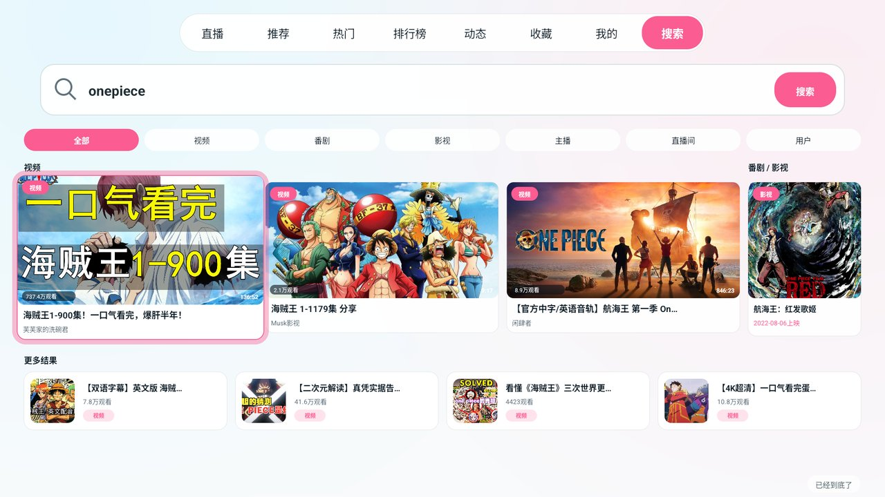
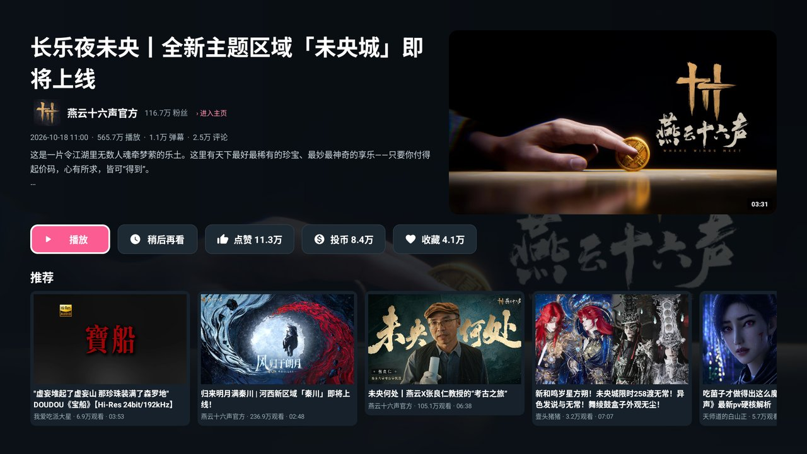
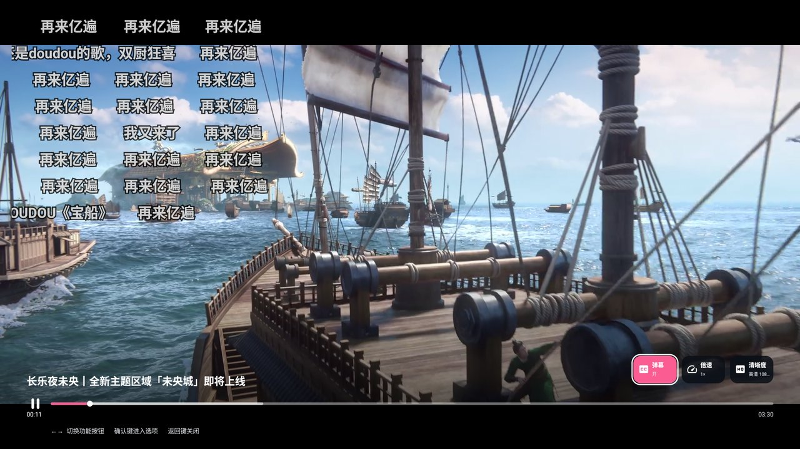
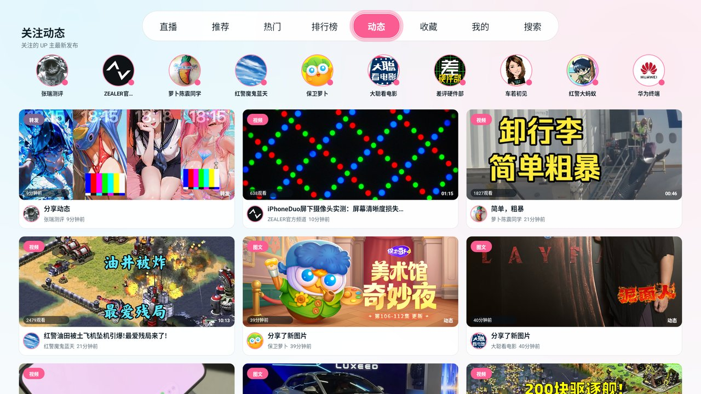
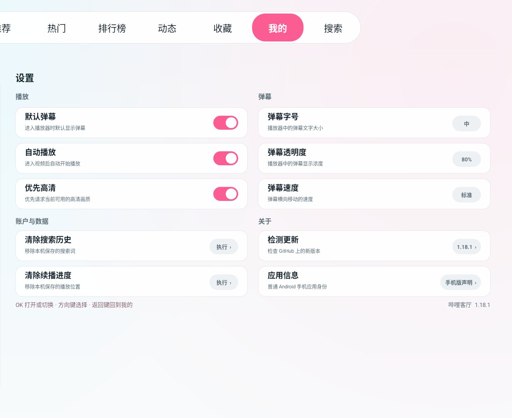

# 哔哩客厅（bilibili网页封装TV版）

一个面向遥控器操作的 B 站 Android 大屏客户端。产品结构与交互模型转译自 GPL-2.0 项目 [ATV-Bilibili-demo](https://github.com/yichengchen/ATV-Bilibili-demo)，并针对 Android 重写；Android 系统层面仍声明为普通手机应用。

当前版本：`1.18.1`（`versionCode 35`，Debug 构建）。

> 公开仓库说明：`qa/` 原始验收截图（含真实账号信息）与 `design/` 设计素材未上传；本仓库 `screenshots/` 为已裁切/挑选的公开截图。详见 `PUBLIC_REPO_NOTE.md`。

## 已实现

- 直播、推荐、热门、排行榜与搜索使用 B 站公开接口获取实时内容
- 搜索页提供 TV 化的热门搜索与本地搜索历史 chip，无需键盘即可选词搜索；保留原生输入框和大屏输入弹层作为手动输入兜底
- 搜索结果可在全部、视频、番剧、影视、主播、直播间、用户间切换；焦点移到分类即直接应用；“全部”首屏按视频、番剧影视和用户/直播分组展示，用户与主播使用头像资料卡，直播间使用 LIVE 横版卡
- 支持电视二维码登录，扫码后将 B 站 Cookie 同步给数据请求与内嵌网页；账号页可退出登录
- 默认打开推荐页签：直播、推荐、热门、排行榜、动态、收藏、我的、搜索
- 所有普通视频缩略图先进入原生视频详情页（标题/UP/日期/播放弹幕评论/简介、封面、播放/稍后再看/点赞/投币/收藏）；多 P 视频底部自动显示「选集」，单 P 显示相关推荐
- 详情页点击 UP 名称/头像可进入原生 UP 主页
- 推荐/热门/排行榜/搜索二级导航加入“番剧”分类；焦点移到分类即直接切换加载（无需确认），选中项粉色
- 主内容使用三列遥控器画廊：当前焦点卡平滑扩展为宽幅主视觉，焦点移走即恢复；搜索结果按内容类型使用 4/6/3 列布局
- 顶部导航“焦点即切换”，移动到直播、推荐、热门、排行榜等页签时无需再次确认
- 视频与直播使用原生全屏播放器（AndroidX Media3 / ExoPlayer）：普通视频/番剧支持 DASH 音视频分轨，直播使用 HLS
- 连续播放：播放结束自动下一集/下一 P；没有选集时自动续播相关推荐视频
- OTA 更新：双栏设置页「关于」分组中的「检测更新」，从 GitHub Release 检查新版本，可下载并通过系统安装器更新
- 竖屏视频按原始宽高比居中播放（左右黑边），横屏视频保持全屏，不再强制拉伸
- UP 主主页、未开播主播页、动态详情均为原生页面（WBI 签名空间接口 / 动态详情接口），不再走 WebView
- 播放页支持原生弹幕、0.75×–2× 倍速和接口返回的清晰度档位；未登录时按实际可用档位自动选择（UGC 通常 720P，PGC/番剧通常 480P），登录后可获得更高档位
- 番剧播放器新增“选集”功能（第 4 项），支持 28+ 集滚动列表、当前集标记与切集播放；多 P 普通视频显示“分P”菜单
- 番剧/多 P 视频播放结束后自动切下一集/下一 P（最后一集/最后一 P 不循环）
- 播放中每 15 秒及暂停/退出时回写播放进度到 B 站历史（普通视频与番剧）
- 播放功能采用两级菜单：先进入弹幕、倍速或清晰度，再从完整选项列表中确认选择
- 弹幕、倍速、清晰度使用进度条右上方的紧凑图标按钮
- 综合、动画、游戏、科技、知识、影视、生活、音乐、美食等二级分类均在原生 TV 网格内加载，不再跳转网页版
- 顶部“动态”显示关注 UP 主的视频、图文、转发与直播动态；“收藏”显示真实账号资料和全部收藏夹目录，遥控器上下切换目录后右侧即时更新，并支持“最近收藏/最多播放”排序与“全部内容/可播放视频”筛选
- “我的”内账号、历史、稍后再看、收藏、追番和设置均使用原生大屏界面；账号头像走独立优先加载通道，避免被大量视频封面请求阻塞
- 设置页的“默认弹幕 / 自动播放 / 优先高清”会持久化，并作为播放器的初始行为
- 接口失败时显示错误原因并支持“按确认键重试”，不再展示示例/伪造内容
- 封面使用不透明原图绘制与居中裁切，并按显示尺寸采样解码，避免整页封面全尺寸占用内存
- Manifest 只声明 `android.intent.category.LAUNCHER`，没有 Leanback/TV 特征；触摸屏标为非必需以兼容盒子安装

## 截图

以下是 1920×1080 Android TV 实机/模拟器界面截图（由 `screenshots/` 提供）：

| 首页 | 搜索 |
| --- | --- |
|  |  |

| 视频详情 | 播放器 |
| --- | --- |
|  |  |

| 动态 | 设置（账号区域已裁切） |
| --- | --- |
|  |  |

## 遥控器

- 首页 `↑ ↓ ← →`：移动焦点；顶部页签在焦点到达时立即切页
- 顶部导航栏按 `↑`：刷新当前页面（不设独立刷新按钮）
- 分类行 `← / →`：移动焦点并立即切换分类，无需再按确认键
- 播放页菜单关闭时 `← / →`：快退 / 快进 10 秒
- 播放页 `↑ / ↓`：呼出功能栏；进入下级菜单后选择具体选项
- 播放页功能栏打开时 `← / →`：在弹幕、倍速、清晰度之间切换
- 播放页 `OK / Enter`：进入下级选项或确认应用；菜单未打开时播放 / 暂停
- `Menu`：搜索
- `Back`：从下级选项返回主菜单、关闭功能菜单、网页后退；个人中心子页返回个人中心；其他内容页返回推荐首页，推荐首页再按一次退出
- 偶发网页兜底链接使用带返回/刷新工具栏的 TV WebView；按 `Menu` 聚焦工具栏，按 `↓` 回到网页正文
- 错误/空状态：`OK / Enter` 重试当前页面

## 构建

要求：

- JDK 17 或更高（本机验证使用 DevEco Studio 内置 JBR 21）
- Android SDK：`compileSdk 35` / `build-tools 35.0.0`
- 在项目根目录创建 `local.properties` 指向 SDK，例如：

```properties
sdk.dir=/Users/you/Library/Android/sdk
```

```bash
./gradlew assembleDebug
```

APK 输出在 `app/build/outputs/apk/debug/app-debug.apk`。

`./gradlew assembleDebug lintDebug` 可同时执行 Lint（当前为 0 errors / 37 warnings，主要是固定横屏、平台 API 建议、WebView JavaScript 与依赖版本提示）。

> B 站公开接口与播放策略可能调整；登录、会员内容、版权地区限制及 DRM 由 B 站服务决定。

## 已知限制

- 推荐/热门/分区/直播/搜索、动态/收藏/历史、排行榜/稍后再看/追番均支持“加载更多”（排行榜为本地分页）
- 刷新：焦点在顶部导航栏时按 `↑` 刷新当前页（列表/搜索/账号子页均适用）
- 番剧/多 P 支持自动连播，但没有“下一集”按钮或循环设置；播放进度已回写 B 站历史
- 1080P/4K 需要登录态与相应账号权限；已用真实账号验证 UGC/番剧 1080P，4K 取决于账号权限；未登录时最高为 UGC 720P / PGC 480P
- 直播已可播放（HLS），但暂无清晰度切换、直播弹幕和断流重连
- 动态详情已支持文本/图片结构，但图片多图布局与转发卡等复杂结构仍需补测；UP 主直播状态行需要 roomId
- 仅支持遥控器/键盘操作，触摸屏设备可安装但无法点击操作
- 非公开 B 站接口可能返回风控（HTTP 412/HTML 页面），此时页面会显示错误与重试入口
- 项目为 Debug 构建，未配置 release 签名与发布渠道

## 许可

本 Android 转译版按 GNU GPL v2 发布。来源与改动说明见 `NOTICE.md`，完整条款见 `LICENSE.md`。
